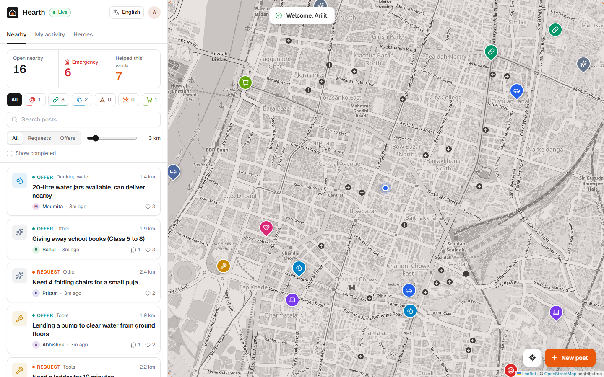

<p align="center"></p>

<h1 align="center">Hearth</h1>
<p align="center"><b>Neighbourhood help, on a live map, in Bengali, Hindi and English.</b><br/>Ask for a hand or lend one: a boat in a flood, medicine, drinking water, a meal, a ride.</p>
<p align="center">Entry for the <a href="https://sficeast.wb.gov.in/en">Seva First Innovation Challenge (Eastern Region)</a>. Themes: Disaster Management & Community Safety · Climate & Flood Resilience · Urban & Civic Innovation · Village & Panchayat Innovation.</p>

<p align="center"></p>

---

## The problem

Every monsoon, waterlogging in Kolkata and floods across West Bengal, Bihar and Jharkhand cut people off from basic help: a boat to reach the main road, insulin when the pharmacy is shut, clean drinking water, a dry room for the night. The help usually exists a few streets away. What's missing is a simple way to **ask, see who nearby needs what, and coordinate** without anyone being missed or two volunteers turning up for the same request.

The same gap exists on ordinary days: an elderly neighbour who needs medicine picked up, a family who needs a lift to the hospital. Today these requests get lost in WhatsApp groups with hundreds of members.

## The solution

Hearth is a free, mobile-friendly web app. No install, no email, just a first name.

1. **Post a request or an offer**, pinned to your street, in your own language.
2. **Neighbours nearby see it instantly** on a live map, filtered by distance and category.
3. **One neighbour taps "I can help".** Claims are race-safe: if two people tap at the same moment, only one succeeds, so nobody is double-booked.
4. **Coordinate in a thread** attached to the post.
5. **Mark it done and send kudos.** Kudos roll up into a neighbourhood Heroes board that recognises active volunteers.

### Built for emergencies

- **Emergency categories first:** Rescue / boat, Medicine, Drinking water, Shelter.
- **Emergency mode:** one tap shows only open emergency posts, most urgent first.
- **Urgency levels** with a pulsing marker for high-urgency requests.
- **Live counts** of open and emergency posts nearby, and help completed this week.

### Built for the region

- **Bengali, Hindi and English** throughout the interface, switchable at any time and remembered on the device. Posts can be written in any language.
- **Runs in any modern mobile browser**; no app store or install needed.
- **Free map data** (OpenStreetMap) and no paid APIs, so running costs stay low.

📄 **The full Innovation & Implementation Plan** (problem, location, beneficiaries, cost, timeline, impact, scalability) is in [docs/IMPLEMENTATION-PLAN.md](docs/IMPLEMENTATION-PLAN.md).

## How it works (technology)

Hearth is a React web app backed by [Appwrite](https://appwrite.io) Cloud. There is no custom server to maintain; Appwrite handles data, permissions, sign-in and live updates.

| Need | How Hearth handles it |
| --- | --- |
| Find help nearby | Every post has a map location; the database returns only posts within the chosen radius (spatial index). |
| No double-booking | Claiming uses a database transaction. A concurrent second claim is rejected and rolled back. |
| Nothing half-saved | Completing a post saves the status, kudos and thank-you message together, or none of them. |
| Live coordination | Realtime updates push new posts, claims and messages to every open screen. |
| Privacy | Only a first name is shown. No phone number or email is collected, and pins can be placed at street level rather than at a front door. |
| Accountability | Every post has a thread, a status (open → in progress → completed) and a record of who helped. |

The data model is three linked tables (posts, messages, kudos) with eight indexes. It's created by `npm run setup`.

## Run it yourself

**Requirements:** Node 20.6+ and a free [Appwrite Cloud](https://cloud.appwrite.io) project.

1. In Appwrite, create a project. Under *Overview → Add platform → Web*, add `localhost`.
2. Create an API key (*Overview → API keys*) with the `databases`, `tables`, `columns`, `indexes` and `rows` scopes. It's used only by the setup scripts, never in the browser.
3. Configure and install:
   ```bash
   cp .env.example .env    # fill in endpoint, project ID and API key
   npm install
   ```
4. Create the database, check it, and add demo data around Kolkata:
   ```bash
   npm run setup     # tables, relationships, indexes (safe to re-run)
   npm run smoke     # verifies every database feature the app relies on
   npm run seed      # a demo neighbourhood with flood-relief and everyday posts
   ```
5. Start the app:
   ```bash
   npm run dev       # http://localhost:5173
   ```

Make sure *Auth → Settings → Anonymous* is enabled (it is by default). To centre the demo elsewhere, change `VITE_DEFAULT_LAT` / `VITE_DEFAULT_LNG` in `.env` and reseed with `npm run seed -- --reset`.

### Deploy

Any static host works (Appwrite Sites, Vercel, Netlify). Build command `npm run build`, output directory `dist`, and set the `VITE_*` variables from `.env.example`. Then add the deployed domain as a Web platform in the Appwrite project.

## Available scripts

| Command | What it does |
| --- | --- |
| `npm run dev` | Start the app locally |
| `npm run build` | Type-check and build the production bundle into `dist/` |
| `npm run setup` | Create the database schema |
| `npm run seed` | Add demo data (`-- --reset` to wipe first, `-- --live-only` to simulate live activity) |
| `npm run smoke` | Check every database feature against your project |

## Tech stack

All open source: [Appwrite](https://appwrite.io) (database, realtime, auth) · [React 19](https://react.dev) · [Vite](https://vite.dev) · TypeScript · [Leaflet](https://leafletjs.com) with [OpenStreetMap](https://www.openstreetmap.org) · [Lucide](https://lucide.dev) icons · Geist and Noto Sans Bengali / Devanagari fonts.

## Project layout

```
docs/IMPLEMENTATION-PLAN.md   the Seva First implementation plan
scripts/setup.mjs             database schema: tables, relationships, indexes
scripts/seed.mjs              demo neighbourhood + live activity simulator
scripts/smoke.mjs             end-to-end check against a live project
src/lib/i18n.ts               English, Bengali and Hindi text
src/lib/api.ts                every database query, transaction and aggregate
src/components/               map, feed, post view, compose form, heroes
```

## License

MIT
